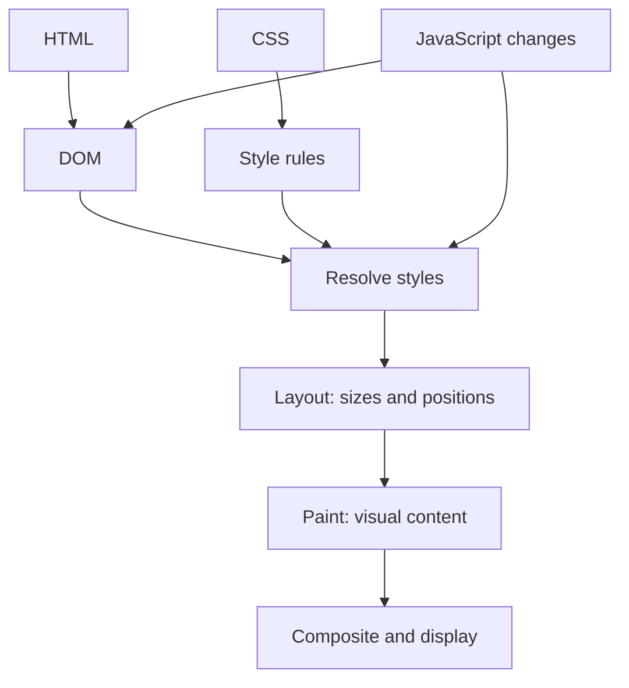
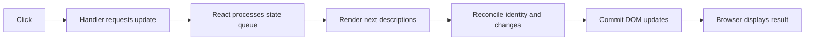
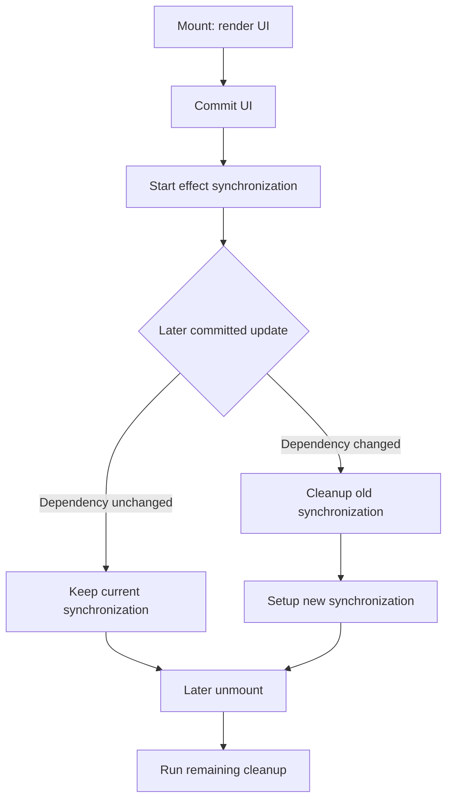
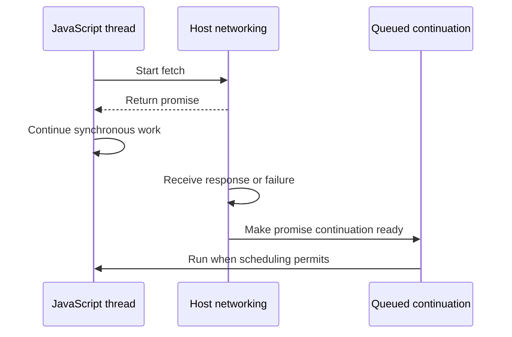
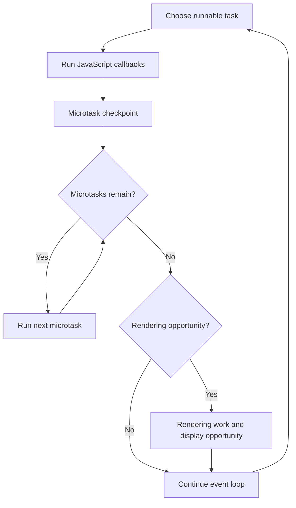
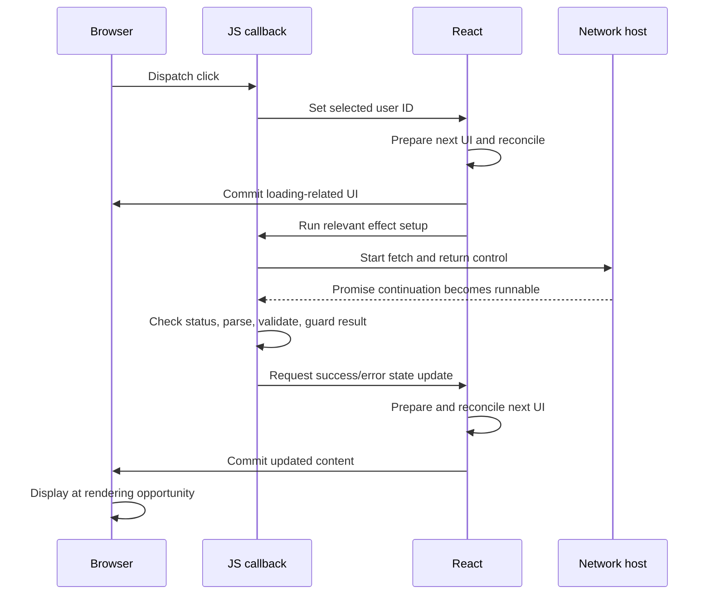

# Deep Explanation: DOM, React Rendering, Lifecycles, and the Event Loop

<a id="question-index"></a>

## Question Index

Click a question to jump to its explanation. Every answer includes a return link.

### DOM and React rendering

- [1. What is the DOM, and what actually exists inside it?](#question-1)
- [2. How does the browser turn HTML and CSS into pixels?](#question-2)
- [3. What is the Virtual DOM in React?](#question-3)
- [4. How are the component tree, element descriptions, Fiber tree, and DOM different?](#question-4)
- [5. What happens on React's initial render?](#question-5)
- [6. What happens when a user clicks a button and changes React state?](#question-6)
- [7. What are reconciliation and diffing, and how are they different?](#question-7)
- [8. What rules determine whether React preserves or replaces something?](#question-8)
- [9. Why do stable list keys matter? Show the real bug.](#question-9)
- [10. Can we implement a tiny diff to understand the idea?](#question-10)
- [11. What is Fiber, and how does concurrent rendering fit in?](#question-11)
- [12. Is the Virtual DOM always faster than directly updating the DOM?](#question-12)

### Components and lifecycle

- [13. How do class and function components actually differ?](#question-13)
- [14. What is the lifecycle-method comparison between classes and hooks?](#question-14)
- [15. What happens during mount, update, and unmount?](#question-15)
- [16. Show equivalent class and function components with real cleanup.](#question-16)
- [17. How do effect dependencies really work?](#question-17)
- [18. How should async effect cleanup handle changing props?](#question-18)
- [19. Why do function components get stale closures?](#question-19)
- [20. How does batching change multiple state updates?](#question-20)
- [21. Why do effects or renders run extra times in development?](#question-21)
- [22. How do layout effects, refs, memoization, and error boundaries fit in?](#question-22)

### Event loop and complete execution flow

- [23. What are an execution context, call stack, and heap?](#question-23)
- [24. If JavaScript runs one callback at a time, how can network requests be asynchronous?](#question-24)
- [25. What does the browser event loop actually do?](#question-25)
- [26. What are tasks and microtasks? Is a macrotask an official queue name?](#question-26)
- [27. Can you trace nested microtasks and a timer step by step?](#question-27)
- [28. When do a promise executor and chained handlers execute?](#question-28)
- [29. What exactly happens at await, even for a plain value?](#question-29)
- [30. Why is setTimeout with zero delay not immediate? What about setInterval?](#question-30)
- [31. Where do browser paint and requestAnimationFrame fit?](#question-31)
- [32. What is microtask starvation, and how do you keep work responsive?](#question-32)
- [33. How is Node.js scheduling different from browser scheduling?](#question-33)
- [34. Can single-threaded JavaScript still have race conditions?](#question-34)
- [35. Connect everything: what happens from a React click to fetched data on screen?](#question-35)
- [36. What are the strongest interview answers and the common incorrect claims?](#question-36)

This guide explains what happens behind the code in simple English. Each question has an answer you can say in an interview, a deeper explanation, and an example or visual. It is aimed at 4–5 years of experience.

**Reading guide:** First learn the flow, then the names. React rendering, browser rendering, and JavaScript scheduling are different systems that work together. Mixing their names is a common source of incorrect interview answers.

**Visuals:** Mermaid diagrams show the flows. If your Markdown viewer does not render Mermaid, read the text walkthrough directly below each diagram. Text snapshots and tables work without a diagram renderer.

**Examples:** Run JavaScript snippets separately. Browser examples require a page. JSX requires a React project. Assume a modern React root unless a section says otherwise. Development Strict Mode can add checks, so lifecycle logs are not guaranteed to appear exactly once. References were checked on October 6, 2026.

# DOM and React Rendering

<a id="question-1"></a>

## 1. What is the DOM, and what actually exists inside it?

[Back to question index](#question-index)

**Interview answer:** “The DOM is the browser's object representation of a document. It forms a tree of nodes that JavaScript can read and update. The HTML source, the DOM tree, and the pixels on the screen are related, but they are different things.”

```html
<section id="profile"><h1>Sam</h1><button>Follow</button></section>
```

Simplified tree, omitting surrounding document nodes and whitespace:

```text
section#profile
├── h1
│   └── Text: "Sam"
└── button
    └── Text: "Follow"
```

**Deep explanation:** An element such as h1 is a node. Its text is another node. The browser exposes objects and methods to inspect these relationships. Document, elements, text, and comments are examples of node kinds. Attributes are exposed through element APIs; do not treat them as ordinary child nodes.

```js
// Browser example after the markup exists.
const heading = document.querySelector("#profile h1");
heading.textContent = "Alex";
console.log(heading.textContent); // Alex
```

This updates the live document model. It does not rewrite the original HTML file on your server. The browser subsequently handles the visual consequences. DOM APIs belong to the web platform; plain Node.js does not have document just because it runs JavaScript. [DOM documentation](https://developer.mozilla.org/en-US/docs/Web/API/Document_Object_Model).

**Follow-up:** Is every DOM node an element? No. A text node is not an element, and `children` and `childNodes` can therefore produce different collections.

<a id="question-2"></a>

## 2. How does the browser turn HTML and CSS into pixels?

[Back to question index](#question-index)

**Interview answer:** “The browser parses HTML into a DOM and CSS into styling rules. It resolves styles, determines layout, paints visual content, and composites the result. A JavaScript update can cause some of these stages to run again.”



**Walkthrough:** HTML establishes document structure. CSS and the cascade determine relevant styles. Layout computes geometry. Painting produces drawing work, and compositing assembles the result for display. This is a simplified conceptual pipeline; browsers optimize and overlap work.

Changing text can affect line wrapping and layout. Changing a background can require painting without changing geometry. Some transform/opacity updates can use compositing without repeating all layout work. A DOM write does not automatically mean an immediate full-page repaint.

```js
// Browser example with an existing .box element.
const box = document.querySelector(".box");
box.style.width = "300px";
const width = box.offsetWidth;
console.log(width);
```

**Why this matters:** Reading geometry after invalidating it can force the browser to produce up-to-date layout synchronously. Repeating write/read pairs in a loop can create expensive layout work. Batch reads before writes when practical and measure the result. [Browser rendering pipeline](https://developer.mozilla.org/en-US/docs/Web/Performance/Guides/How_browsers_work).

<a id="question-3"></a>

## 3. What is the Virtual DOM in React?

[Back to question index](#question-index)

**Interview answer:** “Virtual DOM is a common name for React's in-memory UI descriptions. A component returns elements describing the desired UI. React uses those descriptions and its internal state to decide what to preserve and update in the real DOM.”

```jsx
const element = <h1 className="title">Hello</h1>;
```

Teaching representation, not React's complete internal object format:

```text
type: "h1"
props:
  className: "title"
  children: "Hello"
```

**Deep explanation:** This is a description, not a browser h1 node. Creating the description does not itself append anything to the page. JSX is transformed into JavaScript element-creation calls, using the configured JSX runtime or createElement.

```jsx
import { createElement } from "react";
const element = createElement("h1", { className: "title" }, "Hello");
```

React elements are treated as immutable descriptions. Do not edit their props after creation. Instead, produce the next description from the next state and props. [React element creation](https://react.dev/reference/react/createElement).

**Important correction:** React does not take a fresh complete snapshot of the live browser DOM and compare it on every update. It maintains its own representation of the UI and work. “It compares two DOM copies” is an oversimplification.

<a id="question-4"></a>

## 4. How are the component tree, element descriptions, Fiber tree, and DOM different?

[Back to question index](#question-index)

**Interview answer:** “Components describe UI, elements are their returned descriptions, Fiber holds React's internal work and state, and the DOM holds browser nodes. These structures are connected, but they are not identical.”

| Structure | What it represents | Example |
| --- | --- | --- |
| Component tree | Application composition | App → Profile → FollowButton |
| Element descriptions | Desired rendered output | section, h1, button and their props |
| Fiber work/state structure | React's internal bookkeeping | Component identity, state, pending work, relationships |
| DOM tree | Browser document nodes | Actual section and button objects |

```text
App component
└── Profile component
    ├── h1 host element
    └── FollowButton component
        └── button host element

Browser DOM can contain:
section
├── h1
└── button
```

**Deep explanation:** A function component does not automatically create a DOM wrapper. Profile and FollowButton can exist in React's component structure without corresponding custom DOM elements. Fragments can also group output without introducing a wrapper.

Fiber is an implementation detail. Treat the fields in this table as concepts, not a stable object schema that application code should access. Learn the public behavior first: state belongs to component identity, render prepares output, and commit applies it.

**Follow-up:** Where is hook state stored if a function is called again? React retains it for that component's identity; it is not just a local variable that starts from scratch on every call.

<a id="question-5"></a>

## 5. What happens on React's initial render?

[Back to question index](#question-index)

**Interview answer:** “A root starts the render. React calls components to calculate output, prepares the needed host nodes, commits them to the container, and the browser can display them. Effects synchronize external systems after the relevant commit.”

```jsx
import { createRoot } from "react-dom/client";
function App() { return <h1>Hello</h1>; }
createRoot(document.getElementById("root")).render(<App />);
```

**Conceptual sequence:**

1. A page already contains the root container.
2. React receives an App element description.
3. React executes App and gets an h1 description.
4. The renderer prepares the corresponding nodes.
5. Commit attaches the UI and performs relevant commit work.
6. The browser has an opportunity to display the result.

**Deep explanation:** Calling a component is React rendering. Inserting or editing connected browser nodes is part of committing. Drawing the screen is browser rendering. These are distinct, so “the component rendered” does not establish that pixels have already changed.

Server-rendered pages instead use hydration to connect React to existing HTML. A normal empty-root mount and hydration are not the same startup process. [Render and commit](https://react.dev/learn/render-and-commit).

<a id="question-6"></a>

## 6. What happens when a user clicks a button and changes React state?

[Back to question index](#question-index)

**Interview answer:** “The event handler requests a state update. React processes the queued update and renders the next UI. Reconciliation decides what remains the same. Commit applies the needed changes, and the browser later displays them.”

```jsx
import { useState } from "react";
function Counter() {
  const [count, setCount] = useState(0);
  return <button onClick={() => setCount(value => value + 1)}>{count}</button>;
}
```



**Walkthrough:** Initially, the button's text is zero. The update calculates one. The next description still has a button in the same place. React can retain that button and change its text rather than replacing the whole page.

State setters request work; they do not directly call textContent in your handler. A component can render again even when its host output does not change. In that case, it need not produce a changed DOM node. [React render behavior](https://react.dev/learn/render-and-commit).

**Interview caution:** Do not promise exactly one component invocation for every click across all modes. Development checks and interruptible rendering affect invocation counts.

<a id="question-7"></a>

## 7. What are reconciliation and diffing, and how are they different?

[Back to question index](#question-index)

**Interview answer:** “Reconciliation is React's overall process of matching the next UI with existing UI and preserving or replacing identities. Diffing describes the comparisons used to find changes. It is useful to distinguish deciding the next result from committing it to the DOM.”

**Original teaching example:**

```text
Previous: button(class="primary", text="0")
Next:     button(class="primary", text="1")

Identity: same kind of host element in the same matched position
Change:   text content
Result:   retain button; update its text
```

If the next output is an input instead, preserving the old button as though it were still an input would be wrong. A different component type can also reset the subtree's state.

React uses practical identity rules and heuristics rather than an arbitrary global tree-edit optimization. Keyed list matching and component identity are central to understanding behavior. State preservation is not based on visual similarity. [State identity rules](https://react.dev/learn/preserving-and-resetting-state).

**Deeper point:** Diffing is not necessarily a separate full pass that happens only after every component finishes. Render work includes calculating and reconciling output. The simple stage diagram is a learning model, not a promise about separate internal functions.

<a id="question-8"></a>

## 8. What rules determine whether React preserves or replaces something?

[Back to question index](#question-index)

**Interview answer:** “React uses the component or element type and its position or key within its parent to establish identity. Compatible identity can preserve state and host nodes. Changing that identity can replace the subtree and reset state.”

| Previous → next | What to expect |
| --- | --- |
| button → button, same matched identity | Reuse eligible host node; update changed props/text |
| button → input | Different host type; replacement |
| Counter → Counter, same identity | Preserve Counter state |
| Counter → OtherCounter | Different component type; reset that subtree |
| Counter key=a → Counter key=b | Different identity; reset |
| Same key moved to a different parent | Do not assume state follows globally |

**Deep explanation:** Keys operate among siblings, not as global object IDs. Unkeyed children rely on their position. A stable key lets reordered siblings retain their intended identities, but does not tell React to freeze their props or skip rendering.

**Mistake to avoid:** Defining a component function inside another component creates a new function identity on repeated renders. Declare component types at module level when stable identity is intended.

<a id="question-9"></a>

## 9. Why do stable list keys matter? Show the real bug.

[Back to question index](#question-index)

**Interview answer:** “A key connects a rendered child to the same data item across updates. An index connects it to a position, so inserting an item can move local state to the wrong record.”

```jsx
import { useState } from "react";
function Row({ user }) {
  const [draft, setDraft] = useState(user.name);
  return <input aria-label={`Name for ${user.id}`} value={draft}
    onChange={event => setDraft(event.target.value)} />;
}
function List({ users }) {
  return users.map(user => <Row key={user.id} user={user} />);
}
```

```text
Before insertion:
key=a → Sam   → local draft "Sam edited"
key=b → Alex  → local draft "Alex"

After adding Lee at the beginning:
key=c → Lee   → new local state
key=a → Sam   → keeps "Sam edited"
key=b → Alex  → keeps "Alex"
```

With index keys, the first previous Row is reused for Lee while still holding Sam's draft. The next row can hold another person's draft.

**Code explanation:** The state initializer is used for that Row's initial state, not automatically copied from later prop changes. This deliberately models a local editable draft. A real editor also needs a policy for external name changes. Random keys avoid sharing by remounting everything, but lose state and waste work. [React list keys](https://react.dev/learn/rendering-lists).

<a id="question-10"></a>

## 10. Can we implement a tiny diff to understand the idea?

[Back to question index](#question-index)

**Interview answer:** “I can demonstrate a small description-tree comparison, but I would label it a teaching model. It will not implement React's scheduler, effects, state retention, or complete keyed list reconciliation.”

```js
function diffDescription(previous, next, path = "root", patches = []) {
  if (previous === next) return patches;
  if (previous == null) {
    patches.push({ action: "insert", path });
  } else if (next == null) {
    patches.push({ action: "remove", path });
  } else if (typeof previous === "string" || typeof next === "string") {
    patches.push({ action: typeof previous === typeof next ? "text" : "replace", path });
  } else if (previous.type !== next.type || previous.key !== next.key) {
    patches.push({ action: "replace", path });
  } else {
    const oldProps = previous.props ?? {};
    const newProps = next.props ?? {};
    const keys = new Set([...Object.keys(oldProps), ...Object.keys(newProps)]);
    for (const name of keys) {
      if (!Object.hasOwn(newProps, name)) {
        patches.push({ action: "remove-prop", path, name });
      } else if (!Object.is(oldProps[name], newProps[name]) || !Object.hasOwn(oldProps, name)) {
        patches.push({ action: "set-prop", path, name });
      }
    }
    const oldChildren = previous.children ?? [];
    const newChildren = next.children ?? [];
    for (let index = 0; index < Math.max(oldChildren.length, newChildren.length); index++) {
      diffDescription(oldChildren[index], newChildren[index], `${path}.${index}`, patches);
    }
  }
  return patches;
}

const oldTree = { type: "button", props: { title: "Old" }, children: ["0"] };
const newTree = { type: "button", props: { title: "New" }, children: ["1"] };
console.log(JSON.stringify(diffDescription(oldTree, newTree)));
```

**Output:**

```text
[{"action":"set-prop","path":"root","name":"title"},{"action":"text","path":"root.0"}]
```

**Step-by-step:** Matching button types allow further comparison. Title differs, so a property update is recorded. Child zero changes text, so a text patch is recorded. The function only produces patch descriptions; it does not apply them to a DOM.

**Limits:** Inputs are acyclic trees of string leaves and described host nodes. Children are compared by index; keys trigger replacement at that position but do not cause a keyed search or move. Patches omit payloads and are not an executable DOM patch protocol. Work grows with visited nodes and property comparisons, with recursion space proportional to depth. Real rendering has many additional costs and rules.

<a id="question-11"></a>

## 11. What is Fiber, and how does concurrent rendering fit in?

[Back to question index](#question-index)

**Interview answer:** “Fiber is React's internal work representation. It lets React track component state and organize rendering work. With concurrent features, React can pause, resume, or abandon render work while preserving a consistent committed UI.”

```text
Committed UI: results for "ja"
Prepare lower-priority results for "jav"
New urgent input arrives: "java"
Pause or discard outdated preparation
Prepare latest needed result
Commit the completed chosen result
```

**Deep explanation:** Interruptible rendering means work is coordinated over time. It does not mean all components execute simultaneously on separate JavaScript threads. React also cannot interrupt an arbitrary long synchronous loop in the middle of your component function; that call must return so control can yield.

Avoid side effects in render because a prepared render might never commit. Keep observable subscriptions and DOM synchronization at proper boundaries. Concurrent features distinguish urgent interaction from work that may wait; they do not replace network cancellation or CPU workers. [React's concurrent rendering explanation](https://react.dev/blog/2022/03/29/react-v18).

**Depth limit:** Internal field layouts and exact scheduling mechanisms are not stable public contracts. For interviews, explain the behavior and tradeoffs instead of memorizing private implementation names.

<a id="question-12"></a>

## 12. Is the Virtual DOM always faster than directly updating the DOM?

[Back to question index](#question-index)

**Interview answer:** “No. React adds rendering and comparison overhead. Its benefit is a declarative model and coordinated updates. A focused manual DOM update can be cheaper; a well-designed React app can be easier to maintain and can avoid unnecessary changes.”

**Original comparison:** Updating one known text node manually can be one direct operation. React must process state and calculate output before choosing its DOM operations. Conversely, manually maintaining a complex set of dependent updates is harder and more error-prone.

Performance involves more than the number of DOM writes:

- Component calculation and reconciliation.
- Unnecessary data processing and allocations.
- DOM size, style calculation, layout, and paint.
- Network requests, images, fonts, and hydration.
- Long tasks that delay interaction.

**Practical answer:** Measure a slow user flow with React Profiler and browser performance tools. Fix the largest actual cost. Localize state, avoid needless effect-driven updates, use stable identities, and consider virtualizing very large lists. A tiny diff alone does not make a page fast.

# Classes, Function Components, and Lifecycle

<a id="question-13"></a>

## 13. How do class and function components actually differ?

[Back to question index](#question-index)

**Interview answer:** “A class component uses a persistent instance, its state, and lifecycle methods. A function component is called to calculate UI for a render and uses hooks for retained state and synchronization. Both use React's rendering and identity system.”

| Concern | Class | Function with hooks |
| --- | --- | --- |
| Props | `this.props` | Function parameter |
| State | `this.state`, `this.setState()` | useState/useReducer |
| Per-instance mutable data | Instance fields | useRef |
| UI calculation | render method | Function body |
| External synchronization | Mount/update/unmount methods | Effects with setup and cleanup |
| Shared stateful behavior | Wrappers or other patterns | Custom hooks |

**Deep explanation:** React calls the function again, but it does not forget hook state just because local JavaScript variables are recreated. State belongs to the matched component identity. A plain local variable, however, is not persistent state and changing it does not request a render.

Function components are not inherently “faster components.” Their major benefits include composition and reusable hook logic. Classes are still supported, while functions are the recommended default for new React code. Neither approach removes the need to clean up external work.

**Follow-up:** Does a class instance make rendering safe to mutate? No. Render should still be pure; modifying external state during render is problematic in both styles.

<a id="question-14"></a>

## 14. What is the lifecycle-method comparison between classes and hooks?

[Back to question index](#question-index)

**Interview answer:** “Mount, update, and unmount describe component lifetime. Effects describe starting and stopping synchronization. I can compare them, but useEffect is not a literal replacement for every class method.”

| Class API | Purpose | Function-component approach |
| --- | --- | --- |
| constructor / field initializer | Initialize instance data | useState initializer, useRef; no external setup during render |
| render | Calculate output | Function body; keep it pure |
| componentDidMount | Work after initial commit | Effect setup; layout effect for required pre-paint layout work |
| componentDidUpdate | Work after an update | Dependency-driven effect; cleanup old setup before new setup |
| componentWillUnmount | Release external work | Effect cleanup |
| shouldComponentUpdate / PureComponent | Optional render optimization | memo, appropriate state placement |
| getSnapshotBeforeUpdate | Capture information before DOM update | No direct general hook equivalent; redesign or keep a class |
| getDerivedStateFromProps | Rare state derivation | Usually derive in render or reset by identity; not “put it in an effect” |
| componentDidCatch / getDerivedStateFromError | Error boundary | Class boundary or a library/framework boundary |

**Important:** Class setState shallow-merges object updates; a useState setter replaces that state value. Deprecated unsafe lifecycle methods are not good models for new code. [Class component reference](https://react.dev/reference/react/Component).

<a id="question-15"></a>

## 15. What happens during mount, update, and unmount?

[Back to question index](#question-index)

**Interview answer:** “Mount introduces a component identity, updates recalculate it while preserving eligible state, and unmount removes it and releases associated synchronization. An effect can restart several times while the component remains mounted.”



**Walkthrough:** Suppose a chat component synchronizes with room A. Changing its room prop to B need not unmount the whole component. The effect stops room A and starts room B. Closing the component later stops B.

**Deep explanation:** Component lifetime and effect lifetime are different. “The component mounted once, so the connection should never change” is wrong if its input changes. Dependencies describe when the existing synchronization no longer matches the current inputs. Development checks can add extra setup/cleanup to verify this logic. [Lifecycle of reactive effects](https://react.dev/learn/lifecycle-of-reactive-effects).

**Timing caution:** This diagram represents logical order for one effect. It is not a promise about every parent/child cleanup ordering or an exact browser frame timeline.

<a id="question-16"></a>

## 16. Show equivalent class and function components with real cleanup.

[Back to question index](#question-index)

**Interview answer:** “I will show a timer whose delay can change. The class uses mount, update, and unmount methods. The function describes one synchronization rule with intervalMs as its dependency.”

```jsx
import { Component, useEffect, useState } from "react";

export class ClassTimer extends Component {
  state = { count: 0 };
  timer = null;

  start = () => {
    this.timer = setInterval(() => {
      this.setState(state => ({ count: state.count + 1 }));
    }, this.props.intervalMs);
  };
  stop = () => { clearInterval(this.timer); this.timer = null; };

  componentDidMount() { this.start(); }
  componentDidUpdate(previousProps) {
    if (previousProps.intervalMs !== this.props.intervalMs) {
      this.stop();
      this.start();
    }
  }
  componentWillUnmount() { this.stop(); }
  render() { return <p>Class ticks: {this.state.count}</p>; }
}

export function FunctionTimer({ intervalMs }) {
  const [count, setCount] = useState(0);
  useEffect(() => {
    const timer = setInterval(() => setCount(value => value + 1), intervalMs);
    return () => clearInterval(timer);
  }, [intervalMs]);
  return <p>Function ticks: {count}</p>;
}
```

**Step-by-step:**

1. On mount, each starts one interval.
2. Ticks request increments from the previous state.
3. A changed intervalMs causes the old interval to stop and a new one to start.
4. Tick updates alone do not restart the interval, because the synchronization input is unchanged.
5. Unmount stops the remaining timer.

**What this demonstrates:** The class splits one concern across three lifecycle methods. The effect keeps setup and teardown together. Both retain count across delay changes. The example assumes a positive finite delay supplied by the caller; timer scheduling is not an exact clock.

**Mistake to avoid:** Including count as a dependency unnecessarily and restarting the interval every tick, or capturing count in an empty-dependency effect and repeatedly requesting the same next value.

<a id="question-17"></a>

## 17. How do effect dependencies really work?

[Back to question index](#question-index)

**Interview answer:** “Dependencies are the reactive values the effect uses. React compares them with the previous committed values using Object.is. When they change, cleanup for the previous setup runs before the replacement setup.”

```jsx
useEffect(() => {
  const connection = connect(roomId);
  return () => connection.disconnect();
}, [roomId]);
// Inside a component. useEffect is imported; connect is a stable external helper.
```

**Deep explanation:** Omitting the second argument runs after each relevant commit. Empty dependencies mean no changing reactive inputs drive restarts. They do not guarantee only one setup forever: remounting and development checks matter.

An object built during each render has a new identity even when its properties match. If it is a dependency, that can restart the effect. Move setup-only object creation inside the effect or keep inputs primitive where appropriate. Do not suppress the dependency linter to hide a real relationship. [useEffect reference](https://react.dev/reference/react/useEffect).

**Interview follow-up:** Why not make the effect callback async? Async returns a promise, while an effect setup should return cleanup or nothing. Define and invoke an async function inside the effect instead.

<a id="question-18"></a>

## 18. How should async effect cleanup handle changing props?

[Back to question index](#question-index)

**Interview answer:** “Cleanup must stop obsolete work where possible and prevent obsolete results from changing the current screen. Aborting a fetch and guarding the result solve related but different problems.”

```jsx
import { useEffect, useState } from "react";
export function UserName({ userId }) {
  const [result, setResult] = useState({ id: null, status: "idle" });
  useEffect(() => {
    const controller = new AbortController();
    let active = true;
    setResult({ id: userId, status: "loading" });
    async function load() {
      try {
        const response = await fetch(`/api/users/${encodeURIComponent(userId)}`, {
          signal: controller.signal,
        });
        if (!response.ok) throw new Error(`HTTP ${response.status}`);
        const user = await response.json();
        if (!user || typeof user.name !== "string") throw new Error("Invalid user data");
        if (active) setResult({ id: userId, status: "success", name: user.name });
      } catch (error) {
        if (active && !controller.signal.aborted) {
          setResult({ id: userId, status: "error", message: error.message });
        }
      }
    }
    load();
    return () => { active = false; controller.abort(); };
  }, [userId]);
  if (result.id !== userId || result.status === "idle" || result.status === "loading") {
    return <p role="status">Loading...</p>;
  }
  if (result.status === "error") return <p role="alert">{result.message}</p>;
  return <h1>{result.name}</h1>;
}
```

**Original walkthrough:** A request for A starts. The prop changes to B. Cleanup deactivates A and aborts its signal. The new effect starts B. Even if some old asynchronous processing finishes, active is false for A and it cannot replace B's result. Tagging result with its requested ID also hides an old name during the render before B's effect setup runs.

**Limits:** UserId is a supplied valid identifier. A full application needs authorization, caching, retry UX, and appropriate validation. Do not assume abort undoes a server write. A query library or framework loader can manage these concerns more broadly.

<a id="question-19"></a>

## 19. Why do function components get stale closures?

[Back to question index](#question-index)

**Interview answer:** “Each render creates callbacks that see that render's state snapshot. A delayed callback can therefore see an older value. I choose a functional state update for previous-state calculations or a deliberate latest-value mechanism when that is what the operation needs.”

```jsx
function handleClick() {
  setCount(value => value + 1);
  setTimeout(() => console.log(count), 100);
}
// Inside a component; if this render's count is 0, the timer logs 0.
```

**Deep explanation:** Updating state does not edit the count binding held by the current render. The next render has a different snapshot. This is useful when an operation should retain the values associated with a particular interaction; it is not always a bug. [State as a snapshot](https://react.dev/learn/state-as-a-snapshot).

```jsx
setCount(value => value + 1);
// The update does not require reading an old count captured by the handler.
```

**Class comparison:** A class callback reading this.state later can see the instance's newer state, while a copied local value can still be old. Neither model makes async sequencing automatically safe. Decide whether the callback needs the interaction's snapshot or the latest value, then implement that contract intentionally.

<a id="question-20"></a>

## 20. How does batching change multiple state updates?

[Back to question index](#question-index)

**Interview answer:** “React queues updates and can batch them into a render. Direct value updates use the current render's snapshot; functional updates process the queued previous state.”

```jsx
// Handler A, with count initially 0:
setCount(count + 1);
setCount(count + 1);
setCount(count + 1);
// Three requests to replace count with 1; next state is 1.

// Separate handler B, with count initially 0:
setCount(value => value + 1);
setCount(value => value + 1);
setCount(value => value + 1);
// Queue: 0 -> 1 -> 2 -> 3; next state is 3.
```

**Deep explanation:** Batching is about coordinating updates, not skipping their meaning. It does not turn all updates into the same operation. A setter is not a promise, so awaiting it is not a render-completion API. React also does not batch all separate intentional user interactions into one indefinitely delayed update. [React's state queue](https://react.dev/learn/queueing-a-series-of-state-updates).

**Interview caution:** Modern roots support broader automatic batching than legacy roots. Avoid claiming exact commit counts without stating root mode, development behavior, and whether special APIs force flushing.

<a id="question-21"></a>

## 21. Why do effects or renders run extra times in development?

[Back to question index](#question-index)

**Interview answer:** “Strict Mode runs additional development checks to find impure render logic and missing cleanup. It is not a production rule that everything always executes twice.”

```text
Illustrative initial effect check:
setup subscription
cleanup subscription
setup subscription again

Expected outcome: one active subscription, not two.
```

**Deep explanation:** Extra render invocations expose code that mutates input or performs observable work during render. Extra setup/cleanup exposes subscriptions that were never stopped. Callback refs can also receive extra development checks. Behavior depends on where Strict Mode is enabled; avoid treating a single log pattern as a universal lifecycle contract. [Strict Mode reference](https://react.dev/reference/react/StrictMode).

**Practical debugging:** Do not simply remove Strict Mode to hide the symptom. Verify that one setup has one matching cleanup and that rendering is pure. Development logs are useful evidence, but production performance and exact user-visible behavior should be assessed in a production build.

<a id="question-22"></a>

## 22. How do layout effects, refs, memoization, and error boundaries fit in?

[Back to question index](#question-index)

**Interview answer:** “These APIs solve different problems. Layout effects coordinate necessary pre-paint layout work; refs hold mutable values without requesting a render; memoization can skip work; error boundaries handle certain descendant rendering failures.”

| Tool | Use it for | Do not assume |
| --- | --- | --- |
| useLayoutEffect | Measure/adjust layout before repaint | It is a faster general useEffect |
| useRef | DOM reference or mutable non-render data | Changing current updates the UI |
| memo | Skip eligible parent-driven rerenders when props match | The child never renders again |
| useMemo / useCallback | Cache a result/function identity | Correctness or permanent cache storage |
| Error boundary | Descendant render/lifecycle errors | Catching every fetch rejection or event-handler error |

**Timing:** Layout effects block paint, so keep them short. Passive effects usually allow painting first, but interaction-related timing and layout-effect updates can cause earlier flushing. “UseEffect always runs after paint” is too absolute. [Layout effect timing](https://react.dev/reference/react/useLayoutEffect).

**Refs:** A timer ID can live in a ref because it is not part of displayed state. Do not arbitrarily read/write shared refs during render to bypass snapshot rules. [useRef](https://react.dev/reference/react/useRef).

**Memo:** Props can be unchanged while local state or consumed context changes, which can still render the component. Use profiling; compiler-enabled projects can reduce some manual memoization needs. [memo reference](https://react.dev/reference/react/memo).

**Error handling:** A conventional React error boundary still uses class boundary APIs or a wrapper provided by a library/framework. Handle request failures explicitly in the async flow.

# Event Loop: Deep Explanation

<a id="question-23"></a>

## 23. What are an execution context, call stack, and heap?

[Back to question index](#question-index)

**Interview answer:** “An execution context contains the information needed to run code, such as bindings and the surrounding scope. The call stack tracks active calls. The heap is a useful name for memory used by objects and other runtime data.”

```js
function first() { second(); }
function second() { third(); }
function third() { console.log("done"); }
first();
```

```text
At the deepest call:
TOP    third
       second
       first
BOTTOM surrounding execution

Returns: third -> second -> first
```

**Deep explanation:** Calls push active execution onto the stack and returns remove it. A long synchronous call blocks later JavaScript callbacks on that thread. Stack overflow occurs when too many calls remain active, such as uncontrolled recursion.

Objects can remain reachable after a function returns through references and closures. Garbage collection deals with reachability; it does not simply delete everything from a function when its stack frame ends. “All primitives are on the stack and all objects are on the heap” is not a reliable engine implementation rule. Engines optimize storage. [JavaScript execution model](https://developer.mozilla.org/en-US/docs/Web/JavaScript/Reference/Execution_model).

**Follow-up:** What does run-to-completion mean? Ordinary running JavaScript work finishes before another queued callback on that thread can take over. Host APIs and workers can still make progress elsewhere.

<a id="question-24"></a>

## 24. If JavaScript runs one callback at a time, how can network requests be asynchronous?

[Back to question index](#question-index)

**Interview answer:** “The JavaScript thread starts host work and receives its result later. The browser or Node runtime manages the I/O. JavaScript does not need to stay on the stack waiting for the network.”



**Original walkthrough:** A fetch call returns a promise before the full network work is complete. The program can register handlers and return control. Later, completion allows the promise reactions to run as microtasks at the relevant checkpoint. The reaction itself is ordinary JavaScript and runs on the JavaScript thread.

**Important distinctions:**

- Async I/O is not the same as parallel JavaScript.
- Creating a promise does not automatically create a background thread.
- A heavy promise executor still blocks synchronously.
- A callback is not automatically async; map callbacks run during map.
- A worker is a separate execution environment and communicates explicitly.

The runtime's facilities decide how external work progresses. Browser and Node mechanisms differ, so “every async call goes into a browser Web API box” is too broad.

<a id="question-25"></a>

## 25. What does the browser event loop actually do?

[Back to question index](#question-index)

**Interview answer:** “The event loop coordinates runnable tasks, microtask checkpoints, and rendering opportunities. A useful model is to run a task, drain microtasks, and allow rendering when it is due before continuing with more work.”



**Deep explanation:** The browser has task sources and scheduling choices, not one universal FIFO containing every possible event. Within a source, ordering rules matter. Rendering is not guaranteed after every task. Checkpoints also arise at specified host boundaries, not only after a complete top-level script.

Use this diagram to reason about ordinary examples, not as an exact browser engine implementation. A microtask drain includes new microtasks added during that drain. A task callback cannot be interrupted just because a higher-priority-looking promise handler becomes ready. [HTML event-loop model](https://html.spec.whatwg.org/multipage/webappapis.html#event-loops).

**Interview follow-up:** Is the event loop part of the call stack? No. It coordinates when execution starts; the stack holds the execution that is currently running.

<a id="question-26"></a>

## 26. What are tasks and microtasks? Is a macrotask an official queue name?

[Back to question index](#question-index)

**Interview answer:** “Task is the web standard's term; macrotask is common teaching vocabulary. Promise reactions and queueMicrotask callbacks are microtasks. Timer callbacks and many events are task work. Microtasks are drained at checkpoints before the next task.”

| Work | Typical mechanism | Key behavior |
| --- | --- | --- |
| Timer callback | Task | Waits until eligible and scheduled |
| User interaction handling | Task-related host work | Runs when the host dispatches it |
| Promise then/catch/finally reaction | Microtask | Queued once its prerequisite settlement permits it |
| queueMicrotask callback | Microtask | Explicitly adds checkpoint work |
| Async function continuation after await | Promise-based continuation | Resumes asynchronously |
| requestAnimationFrame | Rendering callback | Not an ordinary zero-delay timer |

**Deep explanation:** A pending promise does not keep polling in the microtask queue. The registered reaction becomes ready when the promise's outcome allows it. The executor of new Promise runs synchronously, which is different from the handlers.

Calling microtasks “higher priority” is acceptable shorthand only if you explain checkpoints. They do not preempt a running synchronous function. [Microtasks and runtime scheduling](https://developer.mozilla.org/en-US/docs/Web/API/HTML_DOM_API/Microtask_guide/In_depth).

<a id="question-27"></a>

## 27. Can you trace nested microtasks and a timer step by step?

[Back to question index](#question-index)

**Interview answer:** “I will print synchronous logs first, track the queue in insertion order, and process new microtasks appended during the checkpoint before moving to the timer.”

```js
console.log("A");
setTimeout(() => {
  console.log("B");
  Promise.resolve().then(() => console.log("C"));
}, 0);
Promise.resolve().then(() => {
  console.log("D");
  queueMicrotask(() => console.log("E"));
});
queueMicrotask(() => console.log("F"));
console.log("G");
```

**Output:**

```text
A
G
D
F
E
B
C
```

| Step | Running work | Microtasks waiting afterward | Printed |
| --- | --- | --- | --- |
| 1 | Initial synchronous code | D, F | A, G |
| 2 | Promise reaction D | F, E | D |
| 3 | Explicit microtask F | E | F |
| 4 | Nested microtask E | Empty | E |
| 5 | Timer callback | C | B |
| 6 | Checkpoint after timer | Empty | C |

**Deep explanation:** E does not jump ahead of F just because it was created by D. F was already queued. The timer does not run until the first checkpoint's work finishes. Its promise handler creates another microtask that runs after the timer callback returns. This isolated example has no unrelated events or React scheduler involved.

<a id="question-28"></a>

## 28. When do a promise executor and chained handlers execute?

[Back to question index](#question-index)

**Interview answer:** “The executor runs during promise construction. Handlers execute later. Each then returns another promise, and the next handler waits for that promise's outcome.”

```js
new Promise(resolve => {
  console.log("executor");
  resolve(2);
})
  .then(value => { console.log("first", value); return value + 1; })
  .then(value => console.log("second", value));
console.log("synchronous end");
```

**Output:**

```text
executor
synchronous end
first 2
second 3
```

**Step-by-step:** Construction logs executor and fulfills the first promise. Registering its handler queues reaction work. The current script continues and logs synchronous end. The first handler later returns three, allowing the second handler to run.

**Deep explanation:** Returning a promise makes the chain adopt its eventual result. Throwing rejects the next promise. A catch that returns a value recovers into fulfillment. “Resolved” can mean a promise has adopted another pending promise, not that it has already fulfilled. [Promise behavior](https://developer.mozilla.org/en-US/docs/Web/JavaScript/Reference/Global_Objects/Promise).

**Mistake:** Starting an operation inside then but forgetting to return it detaches it from the chain's sequencing and error propagation.

<a id="question-29"></a>

## 29. What exactly happens at await, even for a plain value?

[Back to question index](#question-index)

**Interview answer:** “Await evaluates its operand and pauses the async function's continuation. The caller can continue. Even a plain value or an already fulfilled promise resumes the function asynchronously.”

```js
async function run() {
  console.log("inside before await");
  await 42;
  console.log("inside after await");
}
console.log("start");
run();
Promise.resolve().then(() => console.log("other microtask"));
console.log("end");
```

**Output:**

```text
start
inside before await
end
inside after await
other microtask
```

**Step-by-step:** The call enters run immediately. Await schedules its later continuation and returns control. The caller registers another promise reaction, then prints end. Run's continuation was queued first in this example, so its after-await log precedes the other microtask.

An async function always returns a promise. Awaiting a rejected promise throws within that function, so try/catch can handle it. It does not block other runnable work. [Await semantics](https://developer.mozilla.org/en-US/docs/Web/JavaScript/Reference/Operators/await).

**Interview caution:** Extra thenables and returned promise chains can add intermediate jobs. Do not memorize this order as the order of every pair of promises; trace the exact expressions.

<a id="question-30"></a>

## 30. Why is setTimeout with zero delay not immediate? What about setInterval?

[Back to question index](#question-index)

**Interview answer:** “A timer's delay controls when it becomes eligible, not an exact execution time. The callback still waits for scheduling and current work. SetInterval also does not wait for an async callback to finish.”

```js
setTimeout(() => console.log("timer"), 0);
console.log("synchronous");
// synchronous, then timer
```

**Deep explanation:** A long task delays timers. Browsers can clamp nested timer delays and throttle background pages. Passing zero does not bypass the stack or the microtask checkpoint. [Timer timing rules](https://developer.mozilla.org/en-US/docs/Web/API/Window/setTimeout).

Original async polling pattern:

```js
function startPolling(task, delay) {
  let stopped = false;
  let timer;
  async function poll() {
    try { await task(); }
    catch (error) { console.error(error); }
    finally {
      if (!stopped) timer = setTimeout(poll, delay);
    }
  }
  poll();
  return () => { stopped = true; clearTimeout(timer); };
}
```

**Explanation:** A new delay starts only after the current operation finishes, avoiding overlapping work from this poller. Stop prevents future scheduling, but does not cancel the already-running task. Pass a cancellation mechanism if needed. Delay means “wait after completion,” not “start exactly every delay milliseconds.”

<a id="question-31"></a>

## 31. Where do browser paint and requestAnimationFrame fit?

[Back to question index](#question-index)

**Interview answer:** “Paint happens during rendering opportunities, not after every console log or promise. RequestAnimationFrame schedules a callback before a relevant repaint opportunity and is useful for visual updates.”

```js
// Browser example with an existing element.
const box = document.querySelector(".box");
requestAnimationFrame(() => {
  box.style.transform = "translateX(100px)";
});
```

**Deep explanation:** The callback can change what the browser will display in that opportunity. It does not mean a previous state was already painted, nor does it guarantee an exact fixed delay. Callback frequency follows display and host conditions, and background tabs may pause callbacks. [requestAnimationFrame](https://developer.mozilla.org/en-US/docs/Web/API/Window/requestAnimationFrame).

**Original example:** Setting loading true and immediately running a large synchronous calculation may never visibly display the loading UI before the calculation finishes. The JavaScript has not given the browser a useful opportunity to paint. Awaiting an already fulfilled promise is only a microtask yield, so it does not guarantee a frame either.

**Important correction:** React commit means the DOM has been updated; browser paint means pixels are displayed. A layout effect can do more work between those events. Do not claim requestAnimationFrame is simply another macrotask with a fixed spot relative to every timer.

<a id="question-32"></a>

## 32. What is microtask starvation, and how do you keep work responsive?

[Back to question index](#question-index)

**Interview answer:** “Microtasks created by microtasks are drained in the same checkpoint. If the queue never empties, other tasks and rendering can be delayed. I reduce work, yield through appropriate host scheduling, or use a worker for CPU-heavy computation.”

```js
// Finite example; demonstrates microtask chaining, not a recommended work strategy.
let count = 0;
function next() {
  count++;
  if (count < 3) queueMicrotask(next);
  else console.log("microtasks complete");
}
queueMicrotask(next);
setTimeout(() => console.log("timer"), 0);
// microtasks complete, then timer
```

**Original chunking pattern:**

```js
async function processInChunks(items, processItem, batchSize = 100) {
  if (!Number.isInteger(batchSize) || batchSize < 1) throw new RangeError("Invalid batch size");
  for (let index = 0; index < items.length; index++) {
    processItem(items[index]);
    if ((index + 1) % batchSize === 0 && index + 1 < items.length) {
      await new Promise(resolve => setTimeout(resolve, 0));
    }
  }
}
```

**Explanation:** This assumes processItem is synchronous. A timer-based yield gives other host work an opportunity; it does not guarantee a paint at every yield. One expensive item can still block. Batch by time budget when item cost varies substantially.

Awaiting Promise.resolve repeatedly keeps using microtasks, so it is not equivalent to yielding to a later task. A worker can move suitable computation off-thread, but message passing, cloning, and cancellation still need design.

<a id="question-33"></a>

## 33. How is Node.js scheduling different from browser scheduling?

[Back to question index](#question-index)

**Interview answer:** “Node has event-loop phases for timers, poll/I/O, check, and other host work. SetImmediate runs in the check phase. Process.nextTick has a special queue. Browser rendering callbacks are not part of Node's normal event loop.”

Run this example as a **CommonJS file**, such as order.cjs:

```js
console.log("start");
process.nextTick(() => console.log("nextTick"));
Promise.resolve().then(() => console.log("promise"));
queueMicrotask(() => console.log("microtask"));
console.log("end");
```

**Output in that context:**

```text
start
end
nextTick
promise
microtask
```

**Deep explanation:** At that CommonJS boundary, the nextTick queue is handled before the promise/queueMicrotask jobs shown. This is not a rule that nextTick preempts every currently running microtask. ES module evaluation is itself scheduled differently, so copying this top-level example into ESM can change the relative order. [process.nextTick](https://nodejs.org/learn/asynchronous-work/understanding-processnexttick), [setImmediate and module-context ordering](https://nodejs.org/learn/asynchronous-work/understanding-setimmediate).

**Timer comparison:** From top-level code, do not guarantee which of setTimeout(0) and setImmediate runs first. Inside an appropriate I/O callback, the check-phase relationship makes the comparison more predictable. Node 20's libuv change moved timer processing to after poll rather than both before and after; state the environment for advanced ordering answers. [Node event-loop phases](https://nodejs.org/learn/asynchronous-work/event-loop-timers-and-nexttick).

<a id="question-34"></a>

## 34. Can single-threaded JavaScript still have race conditions?

[Back to question index](#question-index)

**Interview answer:** “Yes. Async operations can complete in an order different from their start order. A race occurs when correctness depends on that timing. One JavaScript thread does not automatically make multi-step async logic atomic.”

```text
Request A: search "ja"          starts first, finishes last
Request B: search "javascript"  starts later, finishes first

Without protection:
B displays correct latest results
A later overwrites them with old results
```

**Original guarded pattern:**

```js
function createLatestLoader(load, apply) {
  let latest = 0;
  return async function (input) {
    const request = ++latest;
    const value = await load(input);
    if (request === latest) apply(value);
    return value;
  };
}
```

**Explanation:** Every invocation has a sequence number. After waiting, it applies results only if no later request has started. This version intentionally propagates load errors; the caller must handle them, and UI error state needs the same staleness policy. It does not cancel earlier requests.

React's effect-specific active flag in question 18 implements a related guard. For server writes, also consider idempotency, transactions, and version checks. Frontend request ordering cannot by itself stop duplicate effects or conflicting updates on the server.

<a id="question-35"></a>

## 35. Connect everything: what happens from a React click to fetched data on screen?

[Back to question index](#question-index)

**Interview answer:** “The host dispatches the interaction, React handles the event and requests state work, and the component synchronizes with the request. Network completion later resumes promise-based code. A result requests another render, then React commits and the browser displays the updated UI.”



**Walkthrough:** A click selects an ID. The component renders its requested state. An effect associated with that ID starts the fetch. The network does not keep the JavaScript stack occupied. Later, async continuation validates and applies the result. Another React update prepares and commits the name.

**Critical timing caveats:** This is a logical flow, not a guarantee that loading pixels appear before effect setup or before a very fast response. React scheduling is not identical to the promise microtask queue. A setState in a promise handler does not let you predict every React commit from plain queue rules alone. Cancellation and identity checks are still needed when another click changes the selected ID.

**How to debug:** Check the handler, request parameters, network timing/status, response shape, stale-result guard, state transitions, component identity, and final DOM. A missing visual change may be a request failure, state issue, reconciliation identity issue, or paint delay; these are different diagnoses.

<a id="question-36"></a>

## 36. What are the strongest interview answers and the common incorrect claims?

[Back to question index](#question-index)

| Topic | Incorrect claim | Better explanation |
| --- | --- | --- |
| DOM | HTML source is the live DOM | Parsing creates a live object tree that can differ from the source |
| Virtual DOM | It always makes DOM operations faster | It adds a declarative model and coordinated update work |
| Reconciliation | It guarantees a globally optimal tree edit | It uses identity rules and practical matching heuristics |
| Keys | They only remove warnings | They affect matching, state retention, and replacement |
| Render | Render means the browser has painted | React calculation, DOM commit, and browser display differ |
| Class/function | Hooks are exact lifecycle replacements | Effects describe synchronization; the mapping has limits |
| State | Setter changes my current variable immediately | It queues next state; the current render has a snapshot |
| Effects | Empty dependencies guarantee once forever | Identity lifetime, remounts, and development checks matter |
| Effects | useEffect always runs after paint | Passive-effect timing has interaction and flushing nuances |
| Promises | Executor is a microtask | Executor runs immediately; reactions are queued |
| Await | It blocks the whole thread | It pauses the async function's continuation |
| Microtasks | They interrupt running synchronous code | They run at checkpoints |
| Timers | Zero delay means immediate | It means later eligibility subject to host scheduling |
| Yielding | Awaiting a resolved promise guarantees repaint | Microtask yielding does not guarantee a rendering opportunity |
| Node | All browser queue rules apply unchanged | Node has phases and nextTick/module-context differences |

**Interview-ready React answer:** “React calculates descriptions from state and props, matches them with existing identities, and commits the required changes. Type, position, and stable keys determine what can be preserved. Component rendering and browser painting are different, and render must stay pure because work may be repeated or abandoned.”

**Interview-ready lifecycle answer:** “Classes split external synchronization across mount, update, and unmount methods. An effect puts setup and cleanup together and restarts when its reactive inputs change. It is not an exact replacement for every lifecycle API, especially snapshot and error-boundary methods.”

**Interview-ready event-loop answer:** “JavaScript callbacks execute on a stack. Host facilities manage work such as I/O and timers. At checkpoints, the runtime drains queued microtasks, including new ones created while draining. The host selects later tasks and rendering opportunities. Promises do not preempt running code, timers are not exact clocks, and Node adds its own phase and nextTick rules.”

# Practice Tasks

1. Draw the DOM for a section containing a heading and two buttons, including text nodes.
2. Trace a counter from click to committed text change and distinguish render from paint.
3. Insert a list item at the beginning and explain state retention with ID versus index keys.
4. Extend the teaching diff to report changed payloads; explain why keyed moves need more design.
5. Change intervalMs in both timer components and confirm exactly one interval remains active.
6. Reproduce a stale closure, then explain a snapshot-based versus latest-value requirement.
7. Predict questions 27–29 without executing them, then explain every queued continuation.
8. Compare the Node example in .cjs and .mjs and explain why context matters.
9. Build a slow-request profile screen and ensure older data cannot overwrite newer selection.
10. Record a performance trace for blocked loading UI and investigate the long task before adding memoization.

Use the linked question index to revisit weak areas. Practice explaining the rule and a real project use case, rather than memorizing a definition alone.

# Verification

- Confirmed 36 questions, direct index links, and back-to-index targets.
- Syntax-checked all 14 JavaScript blocks with Node; no syntax failures.
- Ran the documented outputs for questions 10, 27, 28, 29, and 33; all matched.
- Tested basic insert/remove/replace/property cases in the teaching diff and out-of-order completion in the latest-result loader.
- Included 6 Mermaid diagrams plus text trees, queue tables, and lifecycle tables. Diagram rendering depends on your Markdown viewer; the diagrams were not rendered during verification.
- React JSX, DOM examples, and browser paint timing were not integration-tested in a browser. Treat them as explained examples requiring the appropriate application setup.
